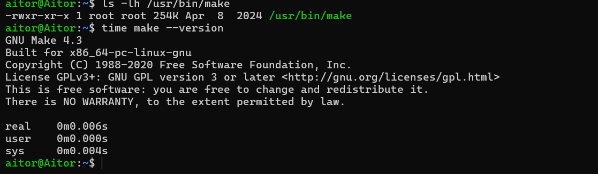
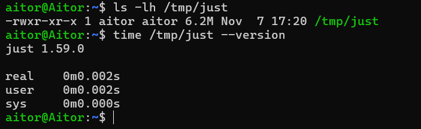
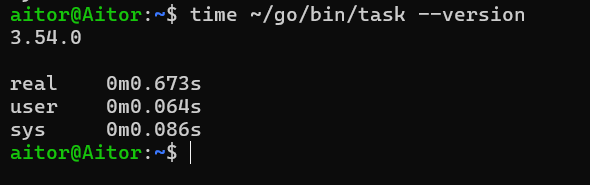

# Gestor de dependencias

**Go Modules:** `go mod`

**Por qué no hay comparación necesaria:**
En Go no hay mucho debate sobre qué gestor de dependencias usar. Desde la versión 1.11, Go Modules viene integrado de fábrica en el propio compilador y es la solución oficial del lenguaje. Herramientas más antiguas como dep o glide ya están totalmente obsoletas. Al usar la herramienta nativa, nos aseguramos de gestionar las versiones de las librerías con el estándar oficial, sin tener que andar instalando software de terceros.

# Gestor de tareas

## Opciones consideradas
- **GNU Make:** Es una herramienta basada en ficheros Makefile que ya viene integrada de serie en casi cualquier sistema tipo Linux/POSIX.
- **Just:** Un lanzador de comandos más moderno y minimalista que usa un archivo justfile para organizar las tareas.
- **Task (go-task):** Un gestor hecho en Go que usa ficheros YAML, por lo que resulta bastante fácil de leer.

## Criterios
Para tomar la decisión, he instalado las tres herramientas en mi entorno WSL y he medido estos aspectos:

1. **Dependencias previas y requisitos de ejecución** — Importa porque el proyecto se va a desplegar en contenedores Docker limpios. Es relevante documentar si se requiere instalar utilidades extra del sistema operativo o intérpretes adicionales en la infraestructura base.
2. **Tiempo de instalación y respuesta** — Importa porque, cada vez que se lanza un workflow de integración continua (CI), la máquina suele partir desde cero. El tiempo que tarda la herramienta en descargarse, configurarse y responder se suma al tiempo total de los despliegues y pruebas automatizadas.

## Análisis de las alternativas

- **GNU Make:** Su tiempo de instalación es nulo, ya que suele venir preinstalado en las imágenes base de Linux o se instala en milisegundos con las dependencias básicas del sistema. A nivel interno, construye un grafo y comprueba qué ficheros han cambiado antes de volver a ejecutarlos. El tiempo de respuesta del comando es de 0.006s.

  *(Evidencia de medición de tiempo)*:
  

- **Just:** Es un simple lanzador de scripts línea a línea, sin evaluar el estado previo de los archivos. Para instalarlo en un entorno limpio desde cero hace falta tener herramientas extra como `curl` y `bash`. Tarda 0.002s en ejecutar, pero la instalación previa de sus dependencias es un requisito.

  *(Evidencia de medición de tiempo)*:
  

- **Task (go-task):** Es un intérprete que orquesta comandos desde un YAML. Para instalarlo hace falta tener el compilador de Go entero o descargar un binario externo. En responder a la terminal tarda 0.673s.

  *(Evidencia de medición de tiempo)*:
  