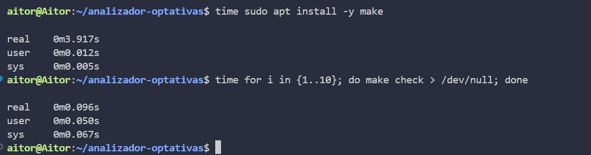
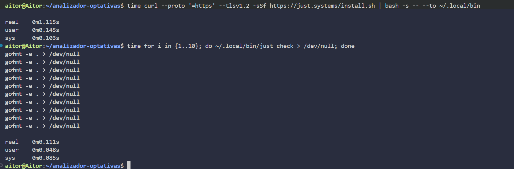
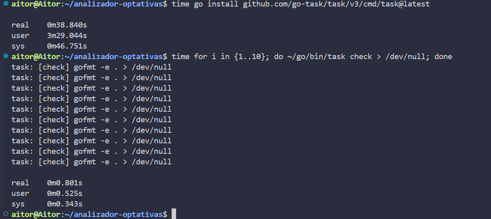

# Gestor de dependencias

**[Go Modules](https://go.dev/ref/mod):** `go mod`

**Por qué no hay comparación necesaria:**
En Go no hay mucho que debatir. Según la documentación oficial de [Go Modules](https://go.dev/ref/mod), el soporte para módulos se introdujo en Go 1.11 y pasó a estar activado por defecto a partir de Go 1.16, integrándose en el propio compilador como el sistema oficial del lenguaje. Herramientas anteriores como [dep](https://github.com/golang/dep) quedaron obsoletas y su repositorio solo sirve como lectura. Usando la herramienta nativa gestionamos las dependencias con el estándar oficial de Go sin instalar software adicional.

# Gestor de tareas

## Criterios
Todas las pruebas las he hecho en mi equipo (WSL con Ubuntu) en las mismas condiciones. Hay que tener en cuenta que Go ya estaba instalado y guardaba en disco librerías descargadas previamente, algo que aprovechan las herramientas que se instalan con go install. Además, para evitar variaciones en una sola ejecución, he lanzado la tarea `check` 10 veces seguidas en cada caso y he sacado la media. Los dos criterios que uso para decidir son:

1. **Tiempo de instalación** — En integración continua el contenedor arranca limpio, así que el tiempo que tarda en descargarse e instalarse la herramienta se suma directamente al tiempo total.
2. **Tiempo medio al ejecutar `check`** — Es la tarea que más veces vamos a lanzar tanto trabajando en local como en cada ejecución de CI.

## Opciones consideradas
Para no quedarme solo con las herramientas de siempre, he mirado tanto gestores clásicos como otras opciones genéricas más recientes:

- **[GNU Make](https://www.gnu.org/software/make/):** Es una herramienta basada en ficheros Makefile.
- **[Just](https://github.com/casey/just):** Un lanzador de comandos que guarda las tareas en un fichero `justfile` con una sintaxis inspirada en Make.
- **[Task (go-task)](https://github.com/go-task/task):** Un gestor hecho en Go donde las tareas se escriben en formato YAML dentro de un `Taskfile.yml`.
- **[Mise](https://github.com/jdx/mise):** Una herramienta que sirve tanto para gestionar versiones de lenguajes como para lanzar tareas definidas en un fichero `mise.toml`.
- **[xc](https://github.com/joerdav/xc):** Un task runner que lee las tareas de un fichero Markdown.

## Análisis de las alternativas

- **GNU Make:** Tarda `3.917s` en instalarse desde los repositorios de Ubuntu. Las 10 ejecuciones de `check` tardan `0.096s` en total, lo que da una media de **`0.0096s`** por ejecución.

  

- **Just:** Tarda `1.115s` en instalarse con su script oficial. Las 10 ejecuciones de `check` tardan `0.111s` en total, con una media de **`0.0111s`** por ejecución.

  

- **Task (go-task):** Tarda `38.840s` en descargarse y compilarse con `go install`. Las 10 ejecuciones de `check` tardan `0.801s` en total, dejando una media de **`0.0801s`** por ejecución.

  