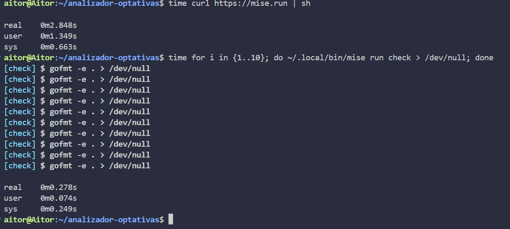
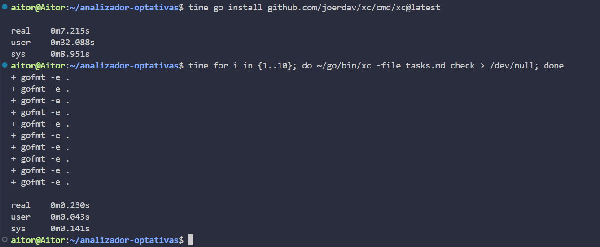

# Gestor de dependencias

**[Go Modules](https://go.dev/ref/mod):** `go mod`

**Por qué no hay comparación necesaria:**
En Go no hay mucho que debatir. Según la documentación oficial de [Go Modules](https://go.dev/ref/mod), el soporte para módulos se introdujo en Go 1.11 y pasó a estar activado por defecto a partir de Go 1.16, integrándose en el propio compilador como el sistema oficial del lenguaje. Herramientas anteriores como [dep](https://github.com/golang/dep) quedaron obsoletas y su repositorio solo sirve como lectura. Usando la herramienta nativa gestionamos las dependencias con el estándar oficial de Go sin instalar software adicional.

# Gestor de tareas

## Criterios
Todas las pruebas las he hecho en mi equipo (WSL con Ubuntu) en las mismas condiciones. Hay que tener en cuenta que Go ya estaba instalado y guardaba en disco librerías descargadas previamente, algo que aprovechan las herramientas que se instalan con go install. Además, para evitar variaciones en una sola ejecución, he lanzado la tarea `check` 10 veces seguidas en cada caso y he sacado la media. Los dos criterios que uso para decidir son:

1. **Tiempo de instalación** — En integración continua el contenedor arranca limpio, así que el tiempo que tarda en descargarse e instalarse la herramienta se suma directamente al tiempo total.
2. **Tiempo medio al ejecutar `check`** — Es la tarea que se ejecutará en cada ejecución de CI, así que su tiempo se suma al de cada una.
## Opciones consideradas
Para no quedarme solo con las herramientas de siempre, he mirado tanto gestores clásicos como otras opciones genéricas más recientes:

- **[GNU Make](https://www.gnu.org/software/make/):** Es una herramienta basada en ficheros Makefile. Según su [manual oficial](https://www.gnu.org/software/make/manual/make.html), está pensada para automatizar qué partes de un programa deben recompilarse cuando cambian otros archivos, además de permitir lanzar cualquier tarea.

- **[Just](https://github.com/casey/just):** Un command runner que guarda las tareas en un fichero `justfile` con una sintaxis inspirada en Make. Según su README, evita las reglas de compilación de Make centrándose solo en ejecutar órdenes.

- **[Task (go-task)](https://github.com/go-task/task):** Un gestor hecho en Go donde las tareas se escriben en formato YAML dentro de un `Taskfile.yml`. Según su [web oficial](https://taskfile.dev/), está inspirado en Make y pensado como una herramienta multiplataforma para usar el mismo workflow en cualquier entorno.

- **[Mise](https://github.com/jdx/mise):** Una herramienta que sirve tanto para gestionar versiones de lenguajes como para lanzar tareas definidas en un fichero `mise.toml`. Según su [documentación](https://mise.jdx.dev/tasks/), permite ejecutar comandos o scripts usando directamente las herramientas y variables de entorno del proyecto para que todo el equipo y CI los lancen igual.

- **[xc](https://github.com/joerdav/xc):** Un task runner que lee las tareas de un fichero Markdown Según su README, busca evitar que la documentación y los scripts se queden desactualizados al unificarlos en el mismo archivo.

## Análisis de las alternativas

- **GNU Make:** Tarda `3.917s` en instalarse desde los repositorios de Ubuntu. Las 10 ejecuciones de `check` tardan `0.096s` en total, lo que da una media de **`0.0096s`** por ejecución.

  

- **Just:** Tarda `1.115s` en instalarse con su script oficial. Las 10 ejecuciones de `check` tardan `0.111s` en total, con una media de **`0.0111s`** por ejecución.

  

- **Task (go-task):** Tarda `38.840s` en descargarse y compilarse con `go install`. Las 10 ejecuciones de `check` tardan `0.801s` en total, dejando una media de **`0.0801s`** por ejecución.

  

- **Mise:** Tarda `2.848s` en instalarse con su instalador oficial. Las 10 ejecuciones de `check` tardan `0.278s` en total, es decir, **`0.0278s`** de media por ejecución.

  

- **xc:** Tarda `7.215s` en descargarse y compilarse mediante `go install`. Las 10 ejecuciones de `check` tardan `0.230s` en total, con una media de **`0.023s`** por ejecución.

  

## Reflexión final
**Herramienta elegida:** Just.

**Por qué la he elegido:**
Es la más rápida de instalar (`1.115s` en comparación a los `2.848s` de Mise o los `3.917s` de GNU Make) y al ejecutar `check` tarda prácticamente lo mismo que Make (`0.0111s` en comparación a `0.0096s`, 1,5 milisegundos de diferencia). En cada ejecución de CI hay que instalar la herramienta y lanzar `check` una vez, así que si sumamos los dos tiempos Just es la más rápida en total (`1.126s` frente a los `3.927s` de Make).