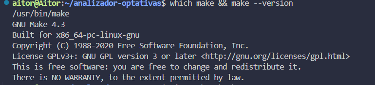
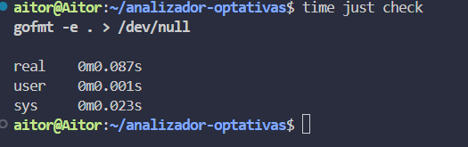
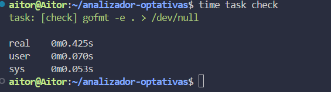

# Gestor de dependencias

**Go Modules:** `go mod`

**Por qué no hay comparación necesaria:**
En Go no hay mucho debate sobre qué gestor de dependencias usar. Desde la versión 1.11, Go Modules viene integrado de fábrica en el propio compilador y es la solución oficial del lenguaje. Herramientas más antiguas como dep o glide ya están totalmente obsoletas. Al usar la herramienta nativa, nos aseguramos de gestionar las versiones de las librerías con el estándar oficial, sin tener que andar instalando software de terceros.

# Gestor de tareas

## Opciones consideradas
- **GNU Make:** Es una herramienta basada en ficheros Makefile que ya viene integrada de serie en casi cualquier sistema tipo Linux/POSIX.
- **Just:** Un lanzador de comandos más moderno y minimalista que usa un archivo justfile para organizar las tareas.
- **Task (go-task):** Un gestor hecho en Go que usa ficheros YAML, por lo que resulta bastante fácil de leer.

## Criterios
Para tomar la decisión, he lanzado las pruebas en mi entorno local (WSL con Ubuntu), sabiendo que no es el entorno real donde acabará corriendo el proyecto (que irá en contenedores y CI). Al medir en local hay elementos que ya tenía de antes y que no estarían en un entorno limpio: los paquetes base del sistema que hacen que Make ya esté disponible, `curl` para instalar Just, o el entorno de Go ya configurado para compilar Task. Aun así, como he probado las tres opciones en las mismas condiciones, la comparativa sigue siendo válida para medir estos dos criterios:

1. **Dependencias previas y requisitos de ejecución** — Importa porque el proyecto se va a desplegar en contenedores Docker limpios. Es relevante documentar si se requiere instalar utilidades extra del sistema operativo o intérpretes adicionales en la infraestructura base.
2. **Tiempo de instalación y ejecución de tareas** — Importa porque, cada vez que se lanza un workflow de integración continua (CI), la máquina suele partir desde cero. El tiempo que tarda la herramienta en descargarse, configurarse y responder se suma al tiempo total de los despliegues y pruebas automatizadas.

## Análisis de las alternativas

- **GNU Make:** Su tiempo de instalación es nulo, ya que suele venir preinstalado en las imágenes base de Linux o se instala en milisegundos con las dependencias básicas del sistema. El tiempo de ejecución de la tarea `check` es de `0.050s`.

  *(Evidencia de que Make ya viene disponible en el sistema)*:
  

  *(Evidencia de ejecución de check)*:
  

- **Just:** Para instalarlo en un entorno limpio desde cero hace falta tener herramientas extra como `curl` y `bash`, tardando `0.710s` en instalarse. En ejecutar la tarea `check` tarda `0.087s`.

  *(Evidencia de instalación)*:
  

  *(Evidencia de ejecución de check)*:
  

- **Task (go-task):** Para instalarlo hace falta tener el compilador de Go entero (`go install`) y añadir su ruta al `PATH`, tardando `33.795s` en instalarse, ya que go install compila el binario en vez de descargar uno ya compilado. En ejecutar la tarea `check` tarda `0.425s`.

  *(Evidencia de instalación)*:
  

  *(Evidencia de ejecución de check)*:
  

## Reflexión final
**Herramienta elegida:** GNU Make.

**Por qué la he elegido:**
Lo que más me ha convencido es que no hay que instalar absolutamente nada y que no exige dependencias previas en el SO (a diferencia de Just o Task). Pensando en el futuro para la integración continua (CI), usar Make me garantiza que no tengo que instalar nada extra ni perder tiempo descargando binarios externos cada vez que se levanta un contenedor, reduciendo así los posibles puntos de fallo. 

