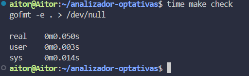
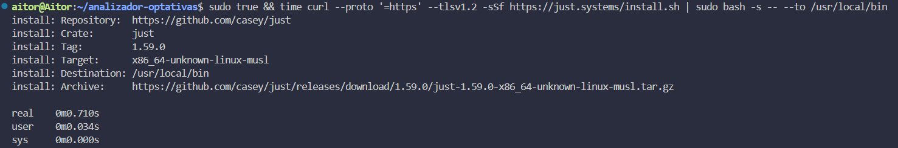
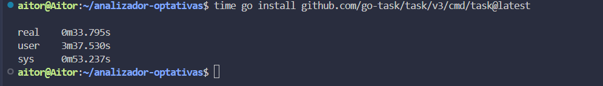

# Gestor de dependencias

**Go Modules:** `go mod`

**Por qué no hay comparación necesaria:**
En Go no hay mucho debate sobre qué gestor de dependencias usar. Desde la versión 1.11, Go Modules viene integrado de fábrica en el propio compilador y es la solución oficial del lenguaje. Herramientas más antiguas como dep o glide ya están totalmente obsoletas. Al usar la herramienta nativa, nos aseguramos de gestionar las versiones de las librerías con el estándar oficial, sin tener que andar instalando software de terceros.

# Gestor de tareas

## Criterios
Para tomar la decisión, he lanzado las pruebas en mi entorno local (WSL con Ubuntu), sabiendo que no es el entorno real donde acabará corriendo el proyecto (que irá en contenedores y CI). Al medir en local hay elementos que ya tenía de antes y que no estarían en un entorno limpio: los paquetes base del sistema que hacen que Make ya esté disponible, `curl` para instalar Just, o el entorno de Go ya configurado para compilar Task. Aun así, como he probado opciones en las mismas condiciones, la comparativa sigue siendo válida para medir estos dos criterios:

1. **Dependencias previas y requisitos de ejecución** — Importa porque el proyecto se va a desplegar en contenedores Docker limpios. Es relevante documentar si se requiere instalar utilidades extra del sistema operativo o intérpretes adicionales en la infraestructura base.
2. **Tiempo de instalación y ejecución de tareas** — Importa porque, cada vez que se lanza un workflow de integración continua (CI), la máquina suele partir desde cero. El tiempo que tarda la herramienta en descargarse, configurarse y responder se suma al tiempo total de los despliegues y pruebas automatizadas.

## Opciones consideradas
Para no quedarme solo con las herramientas de siempre, he mirado tanto gestores clásicos como otras opciones genéricas más recientes:

- **[Mise](https://github.com/jdx/mise):** Gestor moderno que combina control de versiones y tareas (`mise.toml`).
- **[GNU Make](https://www.gnu.org/software/make/):** Es una herramienta basada en ficheros Makefile que ya viene integrada de serie en casi cualquier sistema tipo Linux/POSIX.
- **[Just](https://github.com/casey/just):** Un lanzador de comandos más moderno y minimalista que usa un archivo justfile para organizar las tareas.
- **[Task (go-task)](https://github.com/go-task/task):** Un gestor hecho en Go que usa ficheros YAML, por lo que resulta bastante fácil de leer.
- **[xc](https://github.com/joerdav/xc):** Un task runner bastante nuevo que saca las tareas directamente de los bloques de código del propio `README.md`.
- **[Mask](https://github.com/jacobdeichert/mask):** Un task runner que define las tareas dentro de un fichero Markdown (`maskfile.md`), usando bloques de código como comandos.
- **[Invoke](https://github.com/pyinvoke/invoke):** Una herramienta genérica que permite escribir las tareas como funciones en Python (`tasks.py`).

## Análisis de las alternativas

### Herramientas descartadas por el criterio 1 
Antes de ponerme a medir tiempos en la terminal, hay cuatro opciones que se descartan por el primer filtro, ya que piden instalar intérpretes o binarios externos en un contenedor limpio:

- **xc:** No viene en los repositorios estándar de Linux, así que obliga a descargar su binario aparte o a tener instalado el compilador de Go (`go install`) para montarlo en cada contenedor desde cero.
- **Mise:** Tampoco viene de serie en las imágenes base y exige descargar un binario externo para poder usarlo.
- **Mask:** Igual que los anteriores, no está incluido por defecto en Linux y obliga a bajar su binario externo o tener Cargo para compilarlo.
- **Invoke:** Exige tener instalado todo el intérprete de Python y `pip` en el contenedor base antes de poder instalar y ejecutar la herramienta.

### Comparativa medida de las finalistas
Con las tres opciones que sí encajan mejor, paso a medir ambos criterios en terminal:

- **GNU Make:**
  - *Criterio 1 (Dependencias):* Ninguna, ya viene preinstalado en la mayoría de imágenes base de Linux.
  - *Criterio 2 (Tiempos):* Tiempo de instalación nulo y ejecución de `check` en `0.050s`.

  *(Evidencia de que Make ya viene disponible en el sistema)*:
  

  *(Evidencia de ejecución de check)*:
  

- **Just:**
  - *Criterio 1 (Dependencias):* Obliga a tener instaladas herramientas previas como `curl` y `bash` en un contenedor para poder bajar el binario.
  - *Criterio 2 (Tiempos):* Tarda `0.710s` en instalarse y `0.087s` en ejecutar `check`.

  *(Evidencia de instalación)*:
  

  *(Evidencia de ejecución de check)*:
  

- **Task (go-task):**
  - *Criterio 1 (Dependencias):* Exige tener instalado el compilador completo de Go (`go install`) o bajar binarios externos y tocar el `PATH`.
  - *Criterio 2 (Tiempos):* Tarda `33.795s` en compilarse e instalarse y `0.425s` en ejecutar `check`.

  *(Evidencia de instalación)*:
  

  *(Evidencia de ejecución de check)*:
  

## Reflexión final
**Herramienta elegida:** GNU Make.

**Por qué la he elegido:**
Gana en los dos criterios en comparación al resto, ya que no pide dependencias previas ni descargas externas en contenedores limpios y da los tiempos más bajos tanto al arrancar como al ejecutar tareas. Además, mirando de cara a la integración continua, me ahorra pasos de instalación y quita posibles puntos de fallo.
